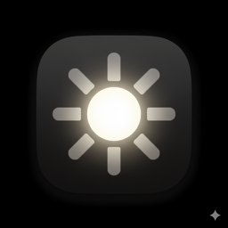

<a id="readme-top"></a>

<br />
<div align="center">
  

  <h3 align="center">Fullbright</h3>

  <p align="center">
    XDR brightness control for MacBook Pro.
    <br />
    <br />
    <a href="https://fullbright.app">Website</a>
    &middot;
    <a href="https://github.com/137137137/Fullbright/issues/new?labels=bug">Report Bug</a>
    &middot;
    <a href="https://github.com/137137137/Fullbright/issues/new?labels=enhancement">Request Feature</a>
  </p>

  [![macOS][macos-shield]][macos-url]
  [![Swift][swift-shield]][swift-url]
  [![License][license-shield]][license-url]
</div>

<br />

<details open>
  <summary>Table of Contents</summary>
  <ol>
    <li><a href="#about">About</a></li>
    <li><a href="#compatibility">Compatibility</a></li>
    <li><a href="#installation">Installation</a></li>
    <li><a href="#usage">Usage</a></li>
    <li><a href="#how-it-works">How It Works</a></li>
    <li><a href="#permissions">Permissions</a></li>
    <li><a href="#building-from-source">Building from Source</a></li>
    <li><a href="#architecture">Architecture</a></li>
    <li><a href="#safety">Safety</a></li>
    <li><a href="#contributing">Contributing</a></li>
    <li><a href="#license">License</a></li>
  </ol>
</details>

## About

MacBook Pro XDR displays go up to 1600 nits but macOS caps you at ~500 in normal use. Fullbright removes that cap.

Menu bar app. Toggles XDR. Intercepts your brightness keys and gives you control over the full 1-1600 nit range. Uses Apple's private SkyLight framework to switch display presets.

Free and open source. I wanted something simple that just did this one thing.

<p align="right">(<a href="#readme-top">back to top</a>)</p>

## Compatibility

| Model | Chip | |
|-------|------|:-:|
| MacBook Pro 14" | M1 Pro/Max+ | ✓ |
| MacBook Pro 16" | M1 Pro/Max+ | ✓ |
| Pro Display XDR | | ✓ |

macOS 26.0+

<p align="right">(<a href="#readme-top">back to top</a>)</p>

## Installation

Download `Fullbright.dmg` from the [latest release](https://github.com/137137137/Fullbright/releases/latest) and drag Fullbright to Applications. It's signed and notarized by Apple, so it opens without warnings. Updates arrive in the app through Sparkle.

Lives in the menu bar. No Dock icon by default (changeable in settings).

<p align="right">(<a href="#readme-top">back to top</a>)</p>

## Usage

1. Click the icon in the menu bar
2. Toggle XDR on
3. Use brightness keys for 1-1600 nit range

Custom OSD shows current nits. Bottom half of the slider is SDR (1-500 nits), top half is XDR (500-1600). Turning XDR off restores your previous brightness and Night Shift state.

<p align="right">(<a href="#readme-top">back to top</a>)</p>

## How It Works

**XDR on:**
1. Night Shift off (its tint would be baked into the gamma baseline), ColorSync restored, and a fresh gamma baseline captured
2. Hardware and linear brightness to 1.0, with the gamma table dimmed by the same amount in the same frame so the screen doesn't flash
3. Ambient light compensation off (it fights gamma changes)
4. A 2×2 borderless window presents EDR-white Metal frames at 5 fps, which makes the window server grant EDR headroom
5. At launch, `SLSConfigureDisplayEnabled` (SkyLight) is called with modes 4, 3, 5, 2, committed for the session only

**Brightness:** the default gamma table is captured once, R/G/B are scaled with vDSP, and each change is a ~0.35s smoothstep fade. A read-back every 2s reapplies the table if something else overwrote it, and turns XDR off if writes keep failing.

**XDR off:** restore gamma, restore Night Shift if it was on, re-enable auto brightness, restore the previous brightness, close the HDR window.

<p align="right">(<a href="#readme-top">back to top</a>)</p>

## Permissions

**Accessibility** required for CGEventTap (brightness key interception). macOS prompts on first use.

Network access only for Sparkle update checks, to `updates.fullbright.app`.

<p align="right">(<a href="#readme-top">back to top</a>)</p>

## Building from Source

```bash
git clone https://github.com/137137137/Fullbright.git
cd Fullbright/Fullbright
open Fullbright.xcodeproj
```

Set your signing team, build. Xcode 26+, macOS 26 SDK. Only dependency is [Sparkle](https://sparkle-project.org) via SPM.

<p align="right">(<a href="#readme-top">back to top</a>)</p>

## Architecture

```
Fullbright/
├── App/
│   ├── AppComposition          Composition root
│   ├── AppCoordinator          Holds the graph, syncs XDR with the hardware
│   ├── AppDelegate             Lifecycle, signal handlers, crash recovery
│   └── FullbrightApp           SwiftUI entry
│
├── Core/
│   ├── Controllers/
│   │   ├── XDRController       Enable/disable/brightness
│   │   ├── GammaTableManager   Read, scale, fade, drift check
│   │   ├── BrightnessKeyManager  CGEventTap, key interception
│   │   ├── DisplayServicesClient  DisplayServices.framework
│   │   ├── NightShiftManager   CBBlueLightClient
│   │   ├── SkyLightDisplayConfigurator  SLSConfigureDisplayEnabled
│   │   └── HDRWindow           Metal view that engages EDR
│   ├── Protocols/
│   └── Utilities/
│
├── Features/
│   ├── MenuBar/
│   ├── OSD/
│   ├── Settings/
│   ├── Onboarding/
│   └── Updates/
│
└── Components/
```

MVVM, `@Observable`, protocol DI via `AppComposition`. Display ops on `@MainActor`. CGEventTap callback is C convention, uses `OSAllocatedUnfairLock` for cross-thread state.

Private frameworks: `SkyLight` (display presets), `DisplayServices` (brightness), `CoreBrightness` (Night Shift).

<p align="right">(<a href="#readme-top">back to top</a>)</p>

## Safety

Apple throttles pixel brightness at the firmware level if the panel overheats. Fullbright can't bypass that.

If the app crashes with modified gamma (screen looks washed out):
- Dirty-gamma flag is set before modifying, cleared after restore
- On next launch, if flag is set, gamma resets immediately
- SIGTERM/SIGINT handlers restore gamma on quit

Relaunch fixes everything. Nothing permanent.

<p align="right">(<a href="#readme-top">back to top</a>)</p>

## Contributing

PRs welcome. Open an issue first for anything big.

<p align="right">(<a href="#readme-top">back to top</a>)</p>

## License

MIT

<p align="right">(<a href="#readme-top">back to top</a>)</p>

<!-- SHIELDS -->
[macos-shield]: https://img.shields.io/badge/macOS-26.0+-111111?style=flat&logo=apple&logoColor=white
[macos-url]: https://www.apple.com/macos/
[swift-shield]: https://img.shields.io/badge/Swift-5.9+-F05138?style=flat&logo=swift&logoColor=white
[swift-url]: https://swift.org
[license-shield]: https://img.shields.io/badge/License-MIT-97CA00?style=flat
[license-url]: https://github.com/137137137/Fullbright/blob/main/LICENSE
